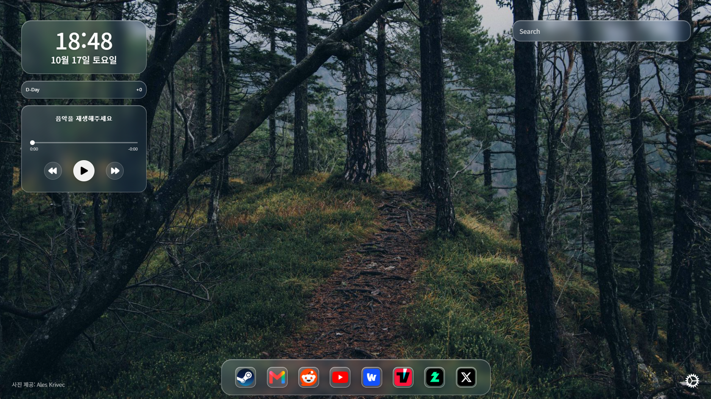
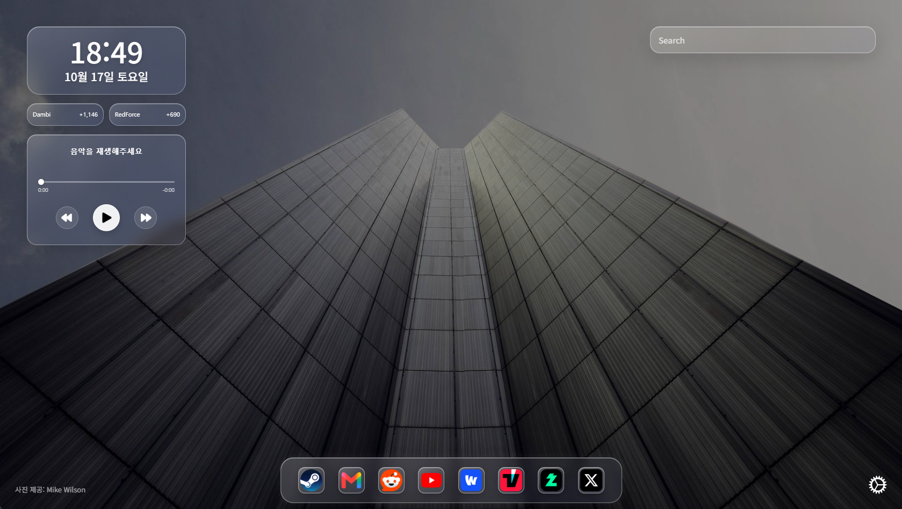

<p align="center">
  
</p>

<h1 align="center">Vitreous</h1>

<p align="center">A calm, customizable new tab for your browser.</p>

<p align="center">
  
  
  
  
</p>

Vitreous brings the essentials of a start page into one simple, glass-inspired space. Keep your time, important dates, music, search, and favorite links close at hand.

## Preview





## Features

- A clock and date with customizable display options
- Up to two D-Day counters
- A music player for supported browser media sessions
- Search and customizable quick links
- Custom image backgrounds and appearance controls
- Interface available in 39 languages

## Install

### Chrome and Edge

1. Extract the Vitreous extension package to a folder.
2. Open `chrome://extensions` in Chrome or `edge://extensions` in Edge.
3. Turn on **Developer mode**.
4. Select **Load unpacked** and choose the extracted Vitreous folder.

### Firefox

1. Extract the Firefox package to a folder.
2. Open `about:debugging#/runtime/this-firefox` in Firefox.
3. Select **Load Temporary Add-on…**.
4. Open the extracted folder and select its `manifest.json` file.

Firefox removes temporary add-ons when it closes. To build the Firefox package from source, run `deno task build` and use the Firefox output in `release/firefox/`.

## Build from source

Install [Deno](https://deno.com/) and run this command from the project root:

```sh
deno task build
```

The browser builds are written to `release/`. To load a build locally, open your browser's extension page, enable developer mode, and load the matching folder.

## License and upstream project

Vitreous is a modified version of [Bonjourr](https://github.com/victrme/Bonjourr), which is licensed under the GNU General Public License v3.0. Vitreous is distributed under the same license. The full license text is available in [LICENSE.md](LICENSE.md).

Vitreous was modified on 2026-10-17. The corresponding source code and build scripts are included in `Vitreous-source-1.0.0.zip`. Keep the license and attribution notices when redistributing Vitreous. This project is independent and is not an official Bonjourr release.

## Credits for reused Bonjourr translations

The contributors below translated Bonjourr, and Vitreous reuses parts of that work. They did not translate or review Vitreous-specific text. New and previously untranslated strings were translated separately with machine translation.

<details>
<summary>View original Bonjourr translation contributors</summary>

The following credits come from Bonjourr and acknowledge the original translations reused by Vitreous. They do not claim that these contributors translated Vitreous-specific text. Vitreous-added strings and missing translations were completed separately with machine translation.

- **🇸🇪 Swedish** · [Benjamin Horn](https://benjaminhorn.io/) · [GitHub](https://github.com/beije)
- **🇳🇱 Dutch** · [Osman Temiz](https://www.reddit.com/user/manllac)
- **🇵🇱 Polish** · [Mateusz K](https://www.reddit.com/user/DiVine92) & [Jakub Mikuło](https://github.com/jmikulo)
- **🇷🇺 Russian** · [OemDef](https://www.reddit.com/user/OemDef)
- **🇨🇳 Simplified Chinese** · Shuhuai Cao · [GitHub](https://github.com/csh980717)
- **🇧🇷 Brazilian Portuguese** · [Adilson Santos](http://adilsonsantos.pages.dev/) · [GitHub](https://github.com/adilsonfsantos)
- **🇸🇰 Slovak** · Tomáš Švec · [GitHub](https://github.com/Svec-Tomas) & Roman Bartík
- **🇨🇿 Czech** · Daniel Zima · [GitHub](https://github.com/ZimaDaniel)
- **🇩🇪 German** · [Bernhard Wittmann](https://bernhardwittmann.com/) · [GitHub](https://github.com/berniwittmann)
- **🇮🇹 Italian** · Trazalca · [GitHub](https://github.com/Trazalca)
- **🇪🇸 Spanish** · [José Alberto](https://github.com/joatb) & [Alí Sinisterra](https://github.com/alisinisterra)
- **🇷🇴 Romanian** · [UnifeGi](https://github.com/UnifeGi) & [Astra](https://dry.nl.eu.org/links)
- **🇺🇦 Ukrainian** · [Anton Boksha](https://antonboksha.dev/) · [GitHub](https://github.com/4doge)
- **🇹🇷 Turkish** · Müslüm Barış Korkmazer · [GitHub](https://github.com/babico)
- **🇮🇩 Indonesian** · Imam Ali Mustofa · [GitHub](https://github.com/darkterminal)
- **🇩🇰 Danish** · kar1 · [GitHub](https://github.com/kar1)
- **🇫🇮 Finnish** · jaajko · [Website](https://jaajko.fi/) · [GitHub](https://github.com/jaajko)
- **🇭🇺 Hungarian** · cook3r · [GitHub](https://github.com/cook3r)
- **🇷🇸 Serbian** · [stormigy](https://github.com/stormigy) & [Radoš Milićev](https://github.com/rammba)
- **🇭🇰 Traditional Chinese** · Pu · [GitHub](https://github.com/unknownnumbers)
- **🇬🇷 Modern Greek** · [tseli0s](https://github.com/tseli0s) & [trlef19](https://github.com/trlef19)
- **🇮🇷 Farsi** · ar3h1d · [GitHub](https://github.com/ar3h1d)
- **🇵🇹 European Portuguese** · [harkadya](https://harkadya.com/) & [BlackSpirits](https://github.com/Blackspirits)
- **🇯🇵 Japanese** · [Kou365](https://github.com/Kou365) & stone英里華 (IshiharaErika)
- **🇭🇷 Croatian** · Ghost
- **🇦🇿 Azerbaijani** · Hacıağa Sadıxov · [GitHub](https://github.com/Hajiagha-Sadikhov)
- **🇺🇿 Uzbek** · Uchkun Rakhimov · [GitHub](https://github.com/uchkunr)
- **🇧🇾 Belarusian** · Eduard Račkoŭski · [GitHub](https://github.com/The518thGuy)
- **🇰🇷 Korean** · Kim JeongHyeon · [GitHub](https://github.com/kimtibber)
- **🇹🇼 Taigi (Hanji)** · GHSRobert Ciang · [GitHub](https://github.com/GJRobert)
- **🇮🇳 Telugu** · Hajiaga Sadikhov · [GitHub](https://github.com/Hajiagha-Sadikhov)
- **🇮🇸 Icelandic** · JonGretar · [GitHub](https://github.com/JonGretar)
- **🇮🇳 Hindi** · Shriyash Patil · [GitHub](https://github.com/Shriyash-24)
- **🇮🇳 Marathi** · AKDB · [GitHub](https://github.com/akdbtas)
- **🇲🇹 Maltese** · Lucas Fenech Beaumont · [GitHub](https://github.com/lucasfenech18)
- **🇧🇩 Bengali** · flameydev · [GitHub](https://github.com/flameydev)

</details>
